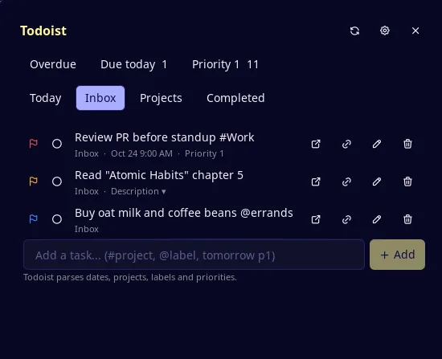
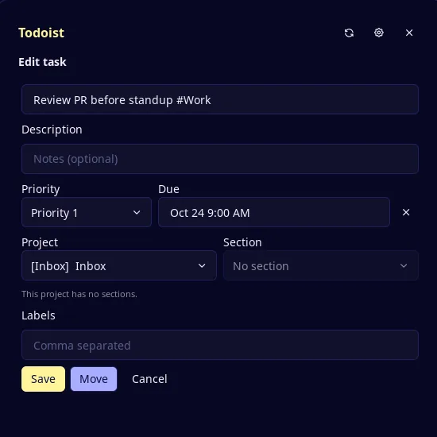
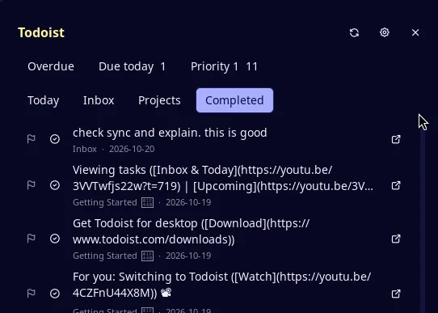
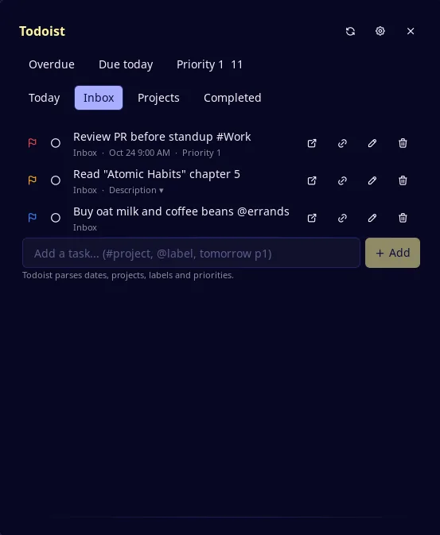

# Todoist Manager

Manage your Todoist tasks from the Noctalia panel and capture new ones from the
launcher — without leaving the shell. Read, complete, edit, move, delete, and
quick-add tasks.

## Screenshots

Inbox view with filter tiles, priority flags, due dates and per-task actions:



Edit form for a task: title, description, priority, due date, project, section and
labels:



Completed view:



Quick capture from the launcher with the `/td` prefix:



## Plugin

| Field | Value |
| --- | --- |
| ID | `snowballons/todoist-manager` |
| Entries | Bar widget: `button`; panel: `manager`; launcher provider: `capture`; service: `core` |
| Launcher Prefix | `/td` |

## Requirements

- Noctalia v5.3.0 or newer (`plugin_api = 33`).
- A Todoist account and an API token (Settings → Integrations → Developer → API
  token). Provide the token in one of these places; the first match wins:
  1. `TODOIST_API_TOKEN` in the environment Noctalia runs in.
  2. The **Token file** setting, for example `~/.config/todoist/token`. The file
     may hold the bare token or a line such as `TODOIST_API_TOKEN = …`;
     `export`, quotes, and `#` comment lines are handled.
  3. The **Token** setting — plain text, stored in Noctalia's settings.
- `chmod` — used to restrict permissions on the plugin data directory and
  cached snapshot.
- `xdg-open` — used to open task links in the browser.

Restrict the token file yourself:

```sh
chmod 600 ~/.config/todoist/token
```

## Usage

Enable **Todoist Manager** in Settings → Plugins, then use any of the entries
below.

### Panel

Open the panel from the bar widget or with:

```sh
noctalia msg panel-toggle snowballons/todoist-manager:manager
```

The panel opens on the last active view. The header row shows **Overdue**,
**Due today**, and **Priority 1** filter tiles with current counts. The nav row
switches between **Today**, **Inbox**, **Projects**, and **Completed**.

Each task row shows a priority flag, a circle checkbox (click to expand
Complete / Reopen), the title, `project · due`, and action buttons:
**Open in Todoist**, **copy link**, **edit** (pencil), **delete** (trash).

- **Completing** a task removes it from the current view and shows a 5-second
  **Undo** toast. Click Undo to reopen it immediately.
- **Edit form** — the pencil opens a form with title, description, priority, due
  date, project, section, and labels. **Save** sends only the changed fields.
  Use **Move** when the project or section changes (the API requires a separate
  endpoint for that). Cancel discards all edits.
- **Completed view** — the Completed nav tab lists tasks completed in the last
  7 days. Click the circle-check on any row to reopen it.
- **Quick Add** — type at the bottom of the Today, Inbox, filter, and project
  views (not **Completed**). Todoist parses the text, so
  `buy milk tomorrow p1 #Errands` works as-is.
- The **refresh** button in the header forces a full re-fetch.

### Launcher

Type `/td` in the Noctalia launcher, then:

- Pick an existing task from the list to jump to it in the panel.
- Type a new task name and pick **Add "…"** to quick-add it.

For example, `/td call the bank friday p2` offers **Add "call the bank friday
p2"**. Todoist's own parser handles `#project`, `@label`, `p1`–`p4`, and dates
in the text — no rewriting is done.

### Bar widget

Add the **Todoist Manager** widget (`snowballons/todoist-manager:button`) from
Settings → Bar. Its checklist glyph toggles the panel.

## Settings

| Setting | Type | Default | Description |
| --- | --- | --- | --- |
| `token` | `string` | *(empty)* | Plain-text API token — stored in Noctalia's settings. Prefer `token_file` or the environment variable. |
| `token_file` | `file` | *(empty)* | Path to a file holding the token. Accepts the bare token or a line like `TODOIST_API_TOKEN = xxx`. |
| `default_project` | `string` | *(empty)* | Shown as a hint under the panel's Quick Add field. Not appended to the text. |
| `default_labels` | `string_list` | *(empty)* | Shown as a hint under the panel's Quick Add field. Not appended to the text. |
| `default_priority` | `select` | `none` | Shown as a hint under the panel's Quick Add field. Not appended to the text. |
| `cache_tasks` | `bool` | `false` | Cache the last loaded tasks to disk so the panel paints before the first request completes. |
| `confirm_delete` | `bool` | `true` | Ask for confirmation in the panel before deleting a task. |
| `max_retries` | `int` | `1` | How many times a failed read or idempotent write is retried (0–3). Create is never retried. |

## IPC

```sh
noctalia msg plugin snowballons/todoist-manager:core all ping
noctalia msg plugin snowballons/todoist-manager:core all refresh
```

`ping` checks the API token and publishes a status. `refresh` forces a full
re-fetch of all views, equivalent to clicking the refresh button in the panel.

## Notes

**Token handling** — the token comes from the first source listed under
Requirements. It is used only in the `Authorization` header to
`api.todoist.com`, and is never logged, written to the cache file, or published
to other plugin entries.

**Cache** — with `cache_tasks` enabled, task data (titles, descriptions, due
dates, projects) is written in plain text to Noctalia's plugin data directory
(directory mode `700`, file mode `600`). Nothing is sent anywhere except the
Todoist API.

**Retry policy** — reads and idempotent mutations (update, move, complete,
reopen, delete) are retried up to `max_retries` times on network errors, server
errors, or 429 rate-limit responses (429 uses a 10-second backoff). Create
(Quick Add) is never retried — a retried POST would duplicate the task. When a
write's response is lost, one `GET /tasks/{id}` settles the outcome instead of
replaying the write.

**Processes** — `chmod` runs when the service starts and after a cache write.
`xdg-open` runs when you choose **Open in Todoist**; if it is missing, the link
is copied instead.

**Known limits** — Quick Add returns no task id, so the plugin refreshes its
views after adding instead of inserting the task locally. There is no
background sync; data is as fresh as the last open or manual refresh. The bar
widget is a plain glyph and shows no count. There is no in-panel search; use
the launcher to find a task. Labels are editable but not shown on task rows.
Sections are assignable but project views are not grouped by them. The UI is
English only.
