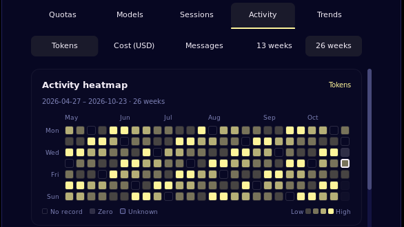

# Token Monitor

Account quotas, model usage, sessions, activity heatmaps and trends from your
existing [Token Monitor](https://github.com/Javis603/token-monitor) Hub, in a native
Noctalia panel and bar widget.

## Plugin

| Field | Value |
| --- | --- |
| ID | `shangshui0302/token-monitor` |
| Entries | Bar widget: `bar`; panel: `panel`; service: `service` (all under `shangshui0302/token-monitor`) |

## Requirements

- Noctalia 5.2.0 or newer (plugin API 32 or newer); tested on Noctalia 5.3.0.
  Native container tooltips used by this plugin set the minimum API requirement.
- A running Token Monitor Hub. Tested against Token Monitor 0.68.0.
  In Token Monitor, choose **Settings → Sync method → Host hub on this device**.
  The default **Local only** mode does not expose the HTTP Hub.
- No extra commands or runtime packages. Provider authentication stays in Token Monitor.

## Usage

1. In **Token Monitor**, choose **Settings → Sync method → Host hub on this
   device** and keep Token Monitor running. Its **Local only** mode does not
   expose the Hub used by this plugin.
2. Enable the plugin in Noctalia and add its **Token Monitor** bar widget.
3. For a Hub on this same computer, keep the default
   `http://127.0.0.1:17321` address and automatic credential lookup enabled.
   Open the panel and select **Test connection** to check both data endpoints.
4. Pin an account in **Quotas** to keep that account in the bar. Explore
   **Models**, **Sessions**, **Activity** and **Trends**, using the time controls.

```sh
noctalia msg panel-toggle shangshui0302/token-monitor:panel
```

Automatic lookup checks Token Monitor's native configuration directory and up
to 32 immediate homes under `~/distrobox/`; it only sends found secrets to
loopback addresses. For another or unusual local path, close the Token Monitor
settings editor if it is open, turn on **Advanced** at the top of Noctalia's
settings, then reopen the editor and set **Credentials file override** in the
plugin's native settings list. For a remote Hub, set its URL and use the same
steps to set **Credentials file override**. Use HTTPS and never send a local
automatically discovered secret to a remote address. A file override always
wins. See the [connection guide](docs/guide.md#first-connection) for exact
paths, Host/Hub terminology, credential formats and troubleshooting.

Configure the plugin through Noctalia: use the panel's gear button or open
**Settings → Plugins → Token Monitor** and select its gear. No hand-written
plugin JSON or TOML is needed; Noctalia saves these settings. Token Monitor
creates `credentials.json` for its own Hub secret storage when Host mode needs
it. That file is credential storage, not plugin configuration. The plugin's
`snapshot.json` and `selection.json` are internal data in Noctalia's plugin
data directory, not settings files to edit.



## Settings

Noctalia presents plugin settings in its native flat list. The **Connection**,
**Display** and **Refresh** headings below are documentation indexes only; they
are not UI tabs or a selector. Most users can leave Noctalia's **Advanced**
switch off. To edit options marked **Advanced**, close the Token Monitor editor
if it is open, turn on **Advanced** at the top of Noctalia's settings, then
reopen the editor.

### Connection

| Setting | Type | Default | Access | Meaning |
| --- | --- | --- | --- | --- |
| `hub_url` | `string` | `http://127.0.0.1:17321` | Regular | HTTP(S) origin of the Hub, without a path, query or embedded credentials |
| `auto_discover_credentials` | `bool` | true | Regular | Find native/local Distrobox credentials for a loopback Hub when no file override is selected |
| `credentials_file` | `file` | empty | Advanced | Explicit file override; required for authenticated remote Hubs or unusual local paths |

### Display

| Setting | Type | Default | Access | Meaning |
| --- | --- | --- | --- | --- |
| `initial_view` | `select` | `quotas` | Regular | Initial tab: quotas, models, sessions, activity or trends |
| `bar_provider` | `select` | `codex` | Regular | Provider shown in the bar; other accounts remain available in the panel |
| `bar_window` | `select` | `first` | Regular | First, session, weekly, or lowest known remaining percentage; a missing requested kind shows unavailable |
| `bar_style` | `select` | `full` | Regular | Provider and value, value only, or icon only |
| `percentage_mode` | `select` | `remaining` | Regular | Display remaining or used quota, with matching labels and meters |
| `show_account_names` | `bool` | true | Regular | Show account/session/project names; disabling also hides session IDs in the UI |
| `panel_density` | `select` | `compact` | Regular | Compact or comfortable card spacing and window preview length |
| `heatmap_weeks` | `select` | `half` | Regular | 26 calendar weeks; `quarter` shows 13 weeks with larger cells |
| `usage_period` | `select` | `today` | Advanced | Producer today, this month or all-time; Sessions retains all-time and shows an unsupported-data notice |
| `history_granularity` | `select` | `daily` | Advanced | Group activity and trends by day or month |
| `heatmap_metric` | `select` | `tokens` | Advanced | Initial heatmap measure: tokens, cost or messages |
| `panel_provider` | `select` | `all` | Advanced | Initial provider filter; the panel also offers filter buttons |
| `accounts_per_page` | `int` | 4 | Advanced | Number of account cards per page, 1–8 |
| `details_per_page` | `int` | 6 | Advanced | Detail rows per page, 2–10 |
| `show_progress` | `bool` | true | Advanced | Show meters for known percentage quotas |
| `show_reset_time` | `bool` | true | Advanced | Show reset countdowns, with local absolute timestamps on hover |
| `show_collection_time` | `bool` | false | Advanced | Show collection age; stale accounts always show it |
| `warning_threshold` | `int` | 20 | Advanced | Warn when remaining percentage is at or below this value, 0–100 |
| `bar_show_icon` | `bool` | true | Advanced | Show the provider icon beside text; shown only when bar style is full or value |
| `bar_account_index` | `int` | 1 | Advanced | Fallback only when no account is pinned; pin a named account from Quotas for a stable selection |

### Refresh

| Setting | Type | Default | Access | Meaning |
| --- | --- | --- | --- | --- |
| `auto_refresh` | `bool` | true | Regular | Periodic polling; disabling it keeps the initial read and manual refresh available |
| `refresh_interval_seconds` | `int` | 60 | Regular | Polling interval, 30–3600 seconds; shown only when automatic refresh is enabled |
| `refresh_on_open` | `bool` | false | Advanced | Request a fresh snapshot when the panel opens |

Use the panel gear or Noctalia's plugin settings. [The user guide](docs/guide.md)
explains display privacy, time periods, missing data, heatmap intensity and quota
window selection. [Provider marks and licenses](assets/README.md) cover all 29
quota providers in Token Monitor 0.68.0, plus New API and Sub2API adapters.

Custom native settings sections are not supported. The Hub does not provide
all-time session records, transcripts, historical quota snapshots or arbitrary
hourly usage breakdowns.
When **Sessions** is set to **All time**, the panel keeps that selection and
shows the unsupported-data notice; choose **Today** or **This month** to view
the available session summaries. The plugin uses the Hub's documented
`/api/stats` and `/api/history` routes only.

## IPC

```sh
# Refresh the shared data snapshot.
noctalia msg plugin shangshui0302/token-monitor:service all refresh
# Open the panel directly on a tab: quotas, models, sessions, activity or trends.
noctalia msg panel-open shangshui0302/token-monitor:panel
noctalia msg plugin shangshui0302/token-monitor:panel all view activity
```

## Notes

- Network: native HTTP `GET /api/stats` and `GET /api/history` on the configured
  Hub, with an optional Bearer secret. Redirects are disabled. The plugin only
  reads snapshots; freshness depends on Token Monitor's collectors.
- Reads: the configured/discovered credentials file, bundled icon font and its
  own cache/selection files. No OAuth token discovery or runtime asset downloads.
- Writes: `snapshot.json` and `selection.json` in `noctalia.pluginDataDir()`.
  The cache contains normalized display data, including account/session labels,
  source scope and receipt times; it excludes secrets, transcripts and raw payloads.
  The privacy toggle hides names in the UI, but does not erase the local cache.
- Processes: none. The plugin does not start a shell, browser or Token Monitor.
- Responses are limited to 4 MiB; quota snapshots support 128 accounts, 32 windows
  per account and 512 windows in total. Oversized snapshots fail explicitly
  while retaining the previous data. Other displayed detail has explicit size limits. Missing values stay
  unknown; a successful Hub request does not imply fresh provider collection.
  [API coverage and limitations](docs/hub-api-assessment.md) describe the contract.
- English strings ship in `translations/en.json`; additional languages use
  Noctalia Translate's human review/export workflow.

For contributing and repeatable checks, see [validation](VALIDATION.md).
