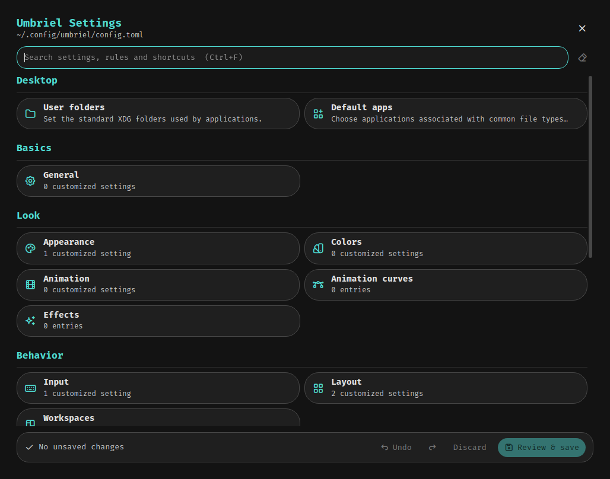
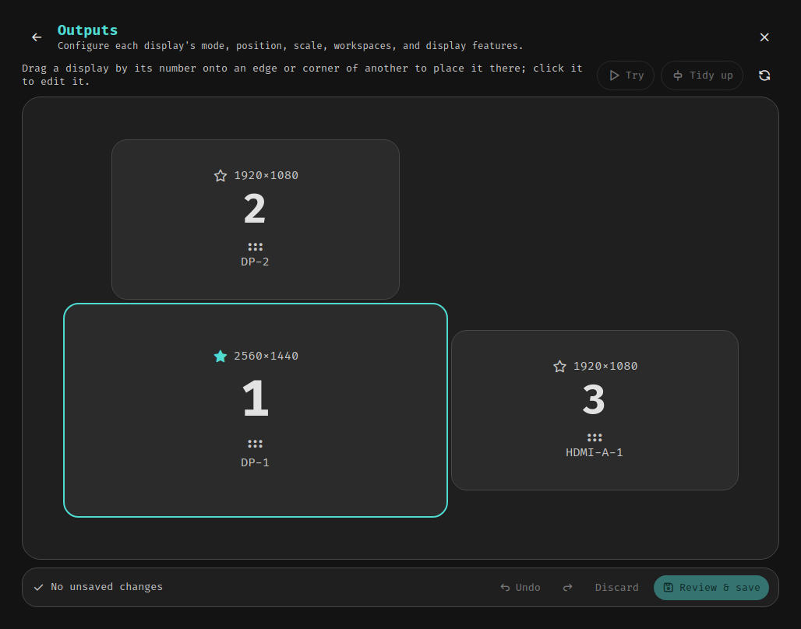

# Umbriel Settings

Edit your whole Umbriel configuration from a Noctalia panel without losing the comments and formatting of
your config: every setting page, window/layer/workspace/security rules, outputs, scratchpads, input devices,
effects, animation curves, environment variables and keybinds, plus XDG user folders and default apps.
The same interface also runs as a standalone app: see the
[Umbriel-Settings repository](https://github.com/0rz0rz0rz/Umbriel-Settings).



## Plugin

| Field | Value |
| --- | --- |
| ID | `0rz0rz0rz/umbriel-settings` |
| Entries | Bar widget: `settings`; panel: `main` |
| Version | `0.2.0` |
| Made for Umbriel | `0.1.0` |
| Needs Noctalia | `5.4.0` or newer (plugin API 43) |

## Requirements

- Noctalia 5.4.0 or newer (plugin API 43) and `python3` 3.11+ (runs the bundled helper).
- `python-tomlkit`: edits the config while keeping its formatting. Without it the panel says what to
  install; user folders and default apps still work.
- `umbriel` on `PATH`: defaults, ranges, validation before saving, the **Outputs** display arrangement and
  mode lists, **Pick from open windows/layers**, **Use the focused window**, live refresh (`umbriel subscribe`)
  and **Run now**.
  Without it settings can still be edited, but aren't checked before writing.
- Optional: `gio` (open the standalone app), `xdg-open` or an
  editor command set under **About** (**Edit file**). Buttons explain what's missing.

## Usage

Add the **Umbriel Settings** widget (`settings`) to a bar from Noctalia's Settings → Bar: it toggles the
panel and turns your accent color while edits are unsaved. Or toggle the panel from a terminal or script:

```sh
noctalia msg panel-toggle 0rz0rz0rz/umbriel-settings:main
```

**Open with a keybind**: the plugin adds no shortcut of its own; bind the command in Umbriel, under
`[keybinds]` in your config or as a `spawn` action on the panel's Keybinds page (pick a free combo):

```toml
[keybinds]
"Mod+Shift+S" = "spawn noctalia msg panel-toggle 0rz0rz0rz/umbriel-settings:main"
```

- **Home** has a search over setting names, help text, config keys (`border_width`), rule names and
  shortcuts, cards for every page with customized/unsaved counts, and **Customized**, a list of every
  setting that differs from Umbriel's default.
- **Setting rows** show the control, the default (“Default 2”), ⓘ help with the config key (with a copy
  button) and undo. Like
  Noctalia's settings, a key that differs from the default shows an **Override** badge, and **Reset** (click
  twice to confirm) removes the key so Umbriel's default applies. Units sit next to
  the number, special values such as “Automatic” (-1) have their own switch, and ↻ marks settings that need
  an Umbriel restart. **Only customized** hides settings at their default; the filter box narrows a page to
  matching settings, and an open group can undo its unsaved edits at once.
- **Rules, devices and effects** are lists (the filter also matches values): edit, name, reorder, duplicate,
  delete. **Pick from open windows** / **Pick from open layers** on a rule fill its match (app id, optionally
  title, or layer namespace) with an exact pattern from what Umbriel shows, and follow windows opening and
  closing; **Use the focused window** takes the focused window's app id.
- **Outputs** shows the connected displays as numbered tiles at their real size and position, filling the
  page. Drag a display by its number (the grip under it) onto an edge of another to place it there, or onto a
  top or bottom corner to place it above or below but shifted half a display that way: displays stay centered on
  each other, and the layout starts at 0, 0 (a display's Position fields set it by hand). **Tidy up**
  recenters after a mode or scale change. The star on a tile marks the default display (click a grey star to
  move it there, the filled one to clear it): it gets the focus at startup (`focus_at_startup`) and is
  XWayland's primary output. Click a display's number to edit it: a name for the overview (kept beside the
  config, not in it), and a Mode picked as Resolution and Refresh rate from the modes Umbriel reports (a
  display without an entry gets one, dropped again if you leave without changing anything). Identical
  monitors that report the same name are told apart by connector. Entries for outputs that aren't connected
  are listed under **Not connected**. Moving displays or picking the default changes nothing on disk until you
  save; then each display's `position` (and `focus_at_startup`) is written to its `[output."…"]` entry.
  **Try** saves display changes right away and asks to keep them; without an answer within 15 seconds the
  previous file comes back (also when the panel was closed) and the changes are unsaved again. The tiles
  follow monitors being plugged in or out.

  
- **Curve, effect and output settings** offer your own named curves, effect presets and pools (also from
  include files) and your configured and connected outputs; **Browse…** picks include files, effect shaders
  and ICC profiles in a file browser of its own (the panel stays above other windows), and for autostart
  commands lists the installed apps like the default apps do. A keybind action's first argument (output,
  preset, pool, submap, scratchpad, named workspace) has a list too.
- **Keyboard layouts**: **Choose…** next to Layout, Variant and XKB options picks from XKB's list.
- **Keybinds** are grouped (shortcuts used twice show **conflict**): build shortcuts from modifier chips (the
  standalone app can also **Record…** a key press), pick actions from a searchable catalog,
  lock shortcuts against accidental changes. **Run now** (click twice) sends the action to Umbriel once;
  session, close/kill, screen-off and submap actions are refused. Window actions act on the window behind
  the panel. Drag groups and shortcuts by their grip to reorder them or
  move a shortcut into another group (↑/↓ buttons on the group list and a shortcut's page do the same);
  the `[keybinds]` table is saved in that order.
- **User folders** and **Default apps** edit `user-dirs.dirs` and `mimeapps.list`.
- **Title-bar colors**: on Colors → Title bar, **KDE** / **KDE header** make a background follow Noctalia's
  palette at the chosen opacity; after one save, palette changes update it even with the panel closed. A
  fixed color stops following. Each config follows on its own.
- **About** shows the version, the Umbriel and Noctalia versions it is made for (and notes when your Umbriel
  differs), options your Umbriel has that aren't covered yet, and the editor command.

Nothing is written until **Review & save** (Ctrl+S, again to save): the review lists every change with
**Revert**, shows the diff and runs
`umbriel config validate` first; if Umbriel rejects the file, nothing is written and each problem links to
its setting. Unsaved edits (including folders and default apps) survive closing the panel and restarting
Noctalia as a draft; edits for another config file wait until that file is open again. Edits made while a
save runs stay unsaved instead of being lost.

Keys: Ctrl+F search, Ctrl+S review (again: save), Ctrl+Z undo the last unsaved edit and Ctrl+Y redo (also
in the save bar), Alt+Left back, Esc close.

## Settings

| Setting | Type | Default | Description |
| --- | --- | --- | --- |
| `display` | `select` | `icon` | What the bar widget shows: `icon`, `icon_text` or `text`; the icon (the text in `text`) takes the accent color while edits are unsaved. A vertical bar always shows only the icon. |
| `icon` | `select` | `moon-stars` | The bar widget's icon: `settings`, `settings-2`, `settings-cog`, `adjustments-horizontal`, `adjustments-cog`, `tool`, `tools`, `moon`, `moon-stars`, `moon-2` or `home-cog`. Unknown values fall back to `moon-stars`. |

## Troubleshooting

- **"python3 was not found"**: install Python 3.11+ so `python3` is on the `PATH` Noctalia was started with.
- **"Python's tomlkit module is missing"**: install `python-tomlkit` (or `pip install --user tomlkit`) and
  reopen the panel. User folders and default apps work without it.
- **"The umbriel command was not found; the config was not validated"**: the panel can't find `umbriel` on
  Noctalia's `PATH`, so it shows no defaults or ranges and can't check the file before saving. Fix the
  `PATH` Noctalia is started with.
- **"… is a symlink; edit its target directly"**: the plugin never writes through a symlinked config,
  `user-dirs.dirs` or `mimeapps.list`. For the config, enter the link's target path on Home instead.
- **Rule, curve or keybind edits disappeared**: the config changed on disk while they were unsaved (another
  editor, the app, a dotfile sync). Setting edits are kept; list edits are dropped so they can't overwrite
  the new file.
- **Widget or panel missing after an update**: run `noctalia msg config-reload`. Errors from the helper are
  shown in the panel; Noctalia's own log is `~/.cache/noctalia/noctalia.log`.

## Notes

- **Look**: colors, font and Noctalia's own controls come from the shell; the panel's cards and rows also
  follow **Corner roundness** (`[shell] corner_radius_scale`, read with `noctalia.getSetting`), live.
- **Files read**: the Umbriel config (last chosen in the panel or app, else `~/.config/umbriel/config.toml`),
  `user-dirs.dirs`, `mimeapps.list`, installed `.desktop` files, qt6ct/KDE color files (KDE title-bar colors),
  `noctalia-config.toml` and the palette file (title bars that follow Noctalia), XKB's
  `rules/evdev.lst` (keyboard layout picker; `$XKB_CONFIG_ROOT` or `/usr/share/X11/xkb`) and the files your
  config includes (`[include]`, for the effect presets, pools and curves they define).
- **Files written**, only when you save, restore or delete backups: the Umbriel config (validated, written
  atomically, symlinks refused), `$XDG_CONFIG_HOME/user-dirs.dirs` and `$XDG_CONFIG_HOME/mimeapps.list` (other
  entries and MIME fallbacks kept). Each write is preceded by a timestamped backup (newest 10 per file) in
  `$XDG_DATA_HOME/umbriel-settings/`, which also holds the chosen config path, rule and display names
  (`gui-labels.json`), keybind locks and the editor command, and `write.lock`, which lets one writer (panel or
  app) save at a time. Drafts, the helper's request/response files and its bytecode cache (`pycache/`) live in
  Noctalia's plugin data directory.
- **Title bars that follow Noctalia**, only after pressing **KDE** / **KDE header**: the user template
  `~/.config/noctalia/templates/umbriel-titlebar.toml`, its `umbriel_titlebar` entry in `noctalia-config.toml`
  (backed up first) and `~/.config/umbriel-settings/titlebar_apply.py`. On palette changes Noctalia renders
  `~/.config/umbriel-settings/titlebar-colors.toml` and runs the script, which sets only `background` /
  `background_unfocused` in `[colors.title_bar]` of each following config (an include can't, because
  Noctalia's umbriel template always loads `noctalia.toml` last).
- **Processes**: `python3 umbriel_settings.py <command>` (JSON request/response files and the helper's
  bytecode cache in the plugin data directory); `umbriel config validate` (on a temporary `.umbriel-settings-*.toml` next to the config,
  removed afterwards), `umbriel config schema --json`, `umbriel outputs --json`, `umbriel windows --json`, `umbriel layers --json`,
  `umbriel keyboard-layouts --json`, `umbriel subscribe <events>` (live refresh, ends after 25 s or the first
  change, while a page that shows live state is open); on button press only: `umbriel focused-window --json`
  (**Use the focused window**), `umbriel msg <action>` (**Run now**),
  `gio launch`, `xdg-open` or your editor. Noctalia runs `python3 titlebar_apply.py`
  after palette changes while a title-bar color follows it.
- **Network**: none.
- `umbriel_core/` is the config library shared with the standalone app, bundled so the plugin works alone.
  `app.luau` is the app's layout; it isn't in `plugin.toml`, so Noctalia never loads it.
- MIT License; see `LICENSE`.
