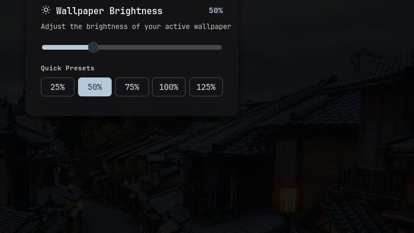

# Wallpaper Brightness

Adjust the brightness of your active desktop wallpaper in real time using a quick slider panel, status bar widget, Control Center shortcut, or plugin settings.



## Plugin

| Field | Value |
| --- | --- |
| ID | `rsmendes/wallpaper-brightness` |
| Entries | Bar widget: `bar`; panel: `panel`; shortcut: `shortcut`; service: `service` |

## Requirements

Install `python3` and Pillow (`python3-pil` / `python-pillow`) on your system.

## Usage

- **Bar Widget (`bar`)**: Click the sun icon on the status bar to open the brightness panel, right-click to open plugin settings, or scroll up/down over the widget to adjust wallpaper brightness in `5%` steps.
- **Control Center Shortcut (`shortcut`)**: Add the **Wallpaper Brightness** tile in Control Center to see the current percentage and toggle the brightness panel.
- **Quick Panel (`panel`)**: Drag the slider (`10%` to `150%`) or click any quick preset button (`25%`, `50%`, `75%`, `100%`, `125%`) to dim or brighten your wallpaper immediately.

You can also toggle the panel from keybindings or scripts via IPC:

```sh
noctalia msg panel-toggle rsmendes/wallpaper-brightness:panel
```

## Settings

| Setting | Type | Default | Description |
| --- | --- | --- | --- |
| `brightness` | `int` | `100` | Wallpaper brightness percentage from `10` to `150` in steps of `5` (`100` keeps the original image). |

## IPC

Control wallpaper brightness directly from terminal scripts or compositor keybindings:

```sh
# Set wallpaper brightness to a specific percentage (10-150)
noctalia msg plugin rsmendes/wallpaper-brightness:service all set 60

# Increase brightness by 5% (or pass a custom step)
noctalia msg plugin rsmendes/wallpaper-brightness:service all up 10

# Decrease brightness by 5% (or pass a custom step)
noctalia msg plugin rsmendes/wallpaper-brightness:service all down 10

# Restore original wallpaper brightness (100%)
noctalia msg plugin rsmendes/wallpaper-brightness:service all reset
```

## Notes

- Automatically detects when you change your wallpaper in Noctalia and applies your chosen brightness level to the new wallpaper across all connected monitors.
- Setting brightness to `100%` (or disabling the plugin) restores your original unmodified wallpaper image.
