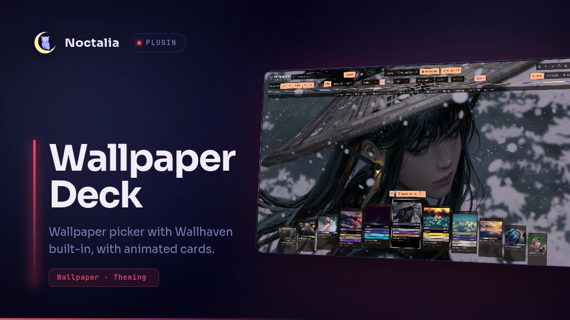

# Wallpaper Deck

A native Noctalia wallpaper picker inspired by Magic: The Gathering cards, featuring Material 3 dynamic color extraction, tiered coverflow navigation, multi-monitor targeting, and Wallhaven search integration.



## Plugin

| Field | Value |
| --- | --- |
| ID | `ishan0121/wallpaper-deck` |
| Entries | Bar widget: `bar`; panel: `picker`; shortcut: `toggle`; service: `service` |

## Requirements

The plugin relies on the following tools available on `PATH`:

- `python3` - Runs the background scanner and color-wheel indexer (`scripts/wallpaper_helper.py`).
- `matugen` - Generates Material 3 color palettes and dynamic contrast tokens from wallpapers.
- `ffmpeg` - Extracts frames and generates fast thumbnail previews.
- `wtype` - Simulates keypress events for smooth swipe gestures.

### Optional Tools

- `swww` or `awww` - Alternative wallpaper daemons supported via the custom command setting.
- `python-pillow` - Accelerates image thumbnail resizing.

## Usage

### Opening the Wallpaper Picker

You can open the picker panel using the Noctalia IPC command or toggle shortcut:

```sh
noctalia msg panel-toggle ishan0121/wallpaper-deck:picker
```

### Bar Widget

Add the `bar` widget to your Noctalia bar under **Settings** (`Mod+Shift+S`) -> **Bar** -> **Widgets**. Left-clicking the widget toggles the wallpaper picker panel.

### Global Shortcut

Enable the `toggle` shortcut in Noctalia Settings or bind `noctalia msg panel-toggle ishan0121/wallpaper-deck:picker` directly in your compositor config:

* **Hyprland**: `bind = $mainMod, W, exec, noctalia msg panel-toggle ishan0121/wallpaper-deck:picker`
* **Niri**: `Mod+W { spawn "noctalia" "msg" "panel-toggle" "ishan0121/wallpaper-deck:picker"; }`
* **Sway**: `bindsym $mod+w exec noctalia msg panel-toggle ishan0121/wallpaper-deck:picker`

### Controls & Keybindings

| Key / Gesture | Action |
| --- | --- |
| `←` / `→` or `h` / `l` | Browse cards left / right |
| `Mouse Wheel` | Scroll smoothly through the card deck |
| `↑` / `↓` or `u` / `d` | Jump 5 cards |
| `Enter` / `Return` | Apply selected wallpaper to active target monitor |
| `Space` | Toggle Peek mode (temporarily hides deck to inspect full wallpaper) |
| `F` | Toggle favourite status on current wallpaper |
| `S` | Cycle sort mode (`Name` -> `Colour` -> `Newest`) |
| `R` | Jump to a random wallpaper |
| `P` | Toggle hi-res preview in Wallhaven mode |
| `Tab` | Switch source tab (`Local` -> `Favourites` -> `Wallhaven`) |
| `/` | Focus search filter bar |
| `Esc` | Close picker panel (or close search input / monitor menu) |
| `Left Click (Card)` | Focus flanking card, or apply if already in center |
| `Right Click (Apply)` | Toggle monitor selection dropdown |
| `Click (Spectrum)` | Jump directly to that color position in the deck |

## Settings

Configurable inside Noctalia Settings (**Settings** -> **Plugins** -> **Wallpaper Deck**):

| Setting | Type | Default | Description |
| --- | --- | --- | --- |
| `wallpaper_dir` | `folder` | `~/Pictures/wallpapers` | Primary directory scanned for wallpapers. |
| `extra_wallpaper_dir` | `folder` | `~/Pictures/WallHaven` | Additional secondary directory scanned for wallpapers. |
| `include_wallhaven_downloads` | `bool` | `true` | Automatically includes the Wallhaven download directory in the local deck. |
| `additional_wallpaper_dirs` | `string` | `""` | Extra directories to scan, separated by commas or colons. |
| `backend_mode` | `select` | `native` | Wallpaper engine mode: `native` (Noctalia surface) or `custom`. |
| `custom_command` | `string` | `swww img "{path}" --transition-type grow --transition-fps 60` | Shell command executed when `backend_mode` is set to `custom`. Supports `{path}` and `{output}`. |
| `post_hook_command` | `string` | `""` | Optional shell hook executed after applying a wallpaper (e.g. `matugen image "{path}"`). |
| `animate_selected_card` | `bool` | `true` | Enables subtle floating bobbing animation on the active center card. |
| `visible_deck_cards` | `int` | `7` | Number of cards rendered simultaneously in the deck (3 to 11). |
| `wallhaven_api_key` | `string` | `""` | Optional API key for Wallhaven (unlocks user collections and NSFW filters). |
| `wallhaven_categories` | `string` | `"111"` | Wallhaven categories bitflag (General/Anime/People, e.g. 111). |
| `wallhaven_purity` | `string` | `"100"` | Wallhaven purity bitflag (SFW/Sketchy/NSFW, e.g. 100 for SFW). |
| `wallhaven_sorting` | `string` | `"date_added"` | Default Wallhaven sort criterion (`date_added`, `toplist`, `views`, `favorites`). |
| `wallhaven_order` | `string` | `"desc"` | Sort direction (`desc` or `asc`). |
| `wallhaven_hires_preview` | `bool` | `false` | Preloads full-resolution backgrounds when browsing Wallhaven cards. |
| `wallhaven_cache_limit_mb` | `int` | `300` | Disk cache quota in megabytes for online previews before auto-pruning. |
| `wallhaven_download_dir` | `folder` | `~/Pictures/WallHaven` | Directory where downloaded Wallhaven wallpapers are stored. |

## IPC

The picker panel can be opened, closed, or toggled via Noctalia's IPC interface:

```sh
# Toggle picker panel
noctalia msg panel-toggle ishan0121/wallpaper-deck:picker

# Open picker panel
noctalia msg panel-open ishan0121/wallpaper-deck:picker

# Close picker panel
noctalia msg panel-close ishan0121/wallpaper-deck:picker
```

## Notes

- **Filesystem & Cache**: Cached thumbnails, Material 3 palettes, and favourites are stored in `~/.cache/wallpaper-deck/`.
- **Processes**: On folder scan, `wallpaper_helper.py` runs asynchronously with thread-pool workers to extract metadata and palettes without blocking the UI thread.
- **Network**: Wallhaven mode queries `https://wallhaven.cc/api/v1` strictly upon user request or search query. Local and Favourites modes do not perform any network operations.
- **Compositor Support**: Compatible with Wayland compositors including Niri, Hyprland, Sway, River, MangoWC, and Labwc.
