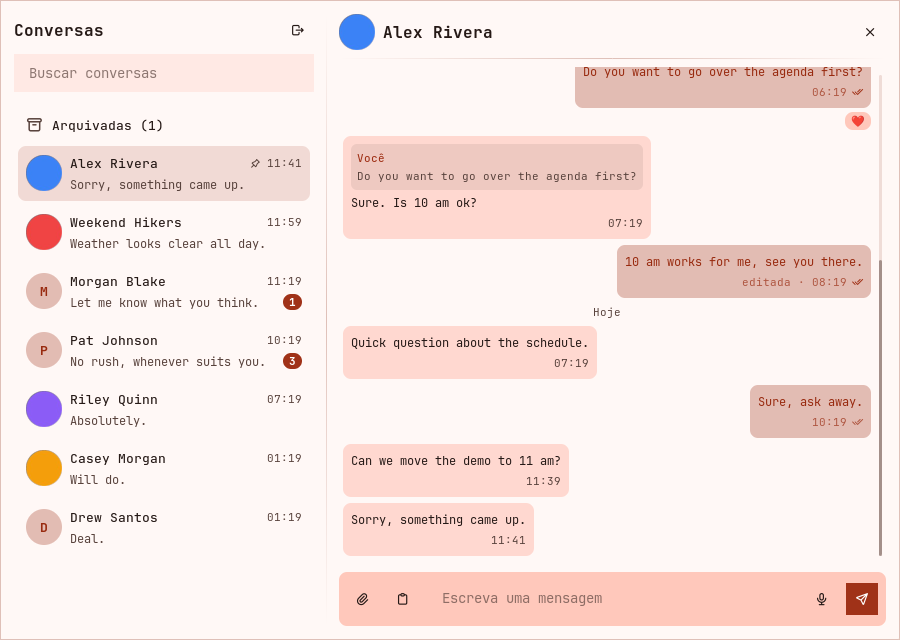
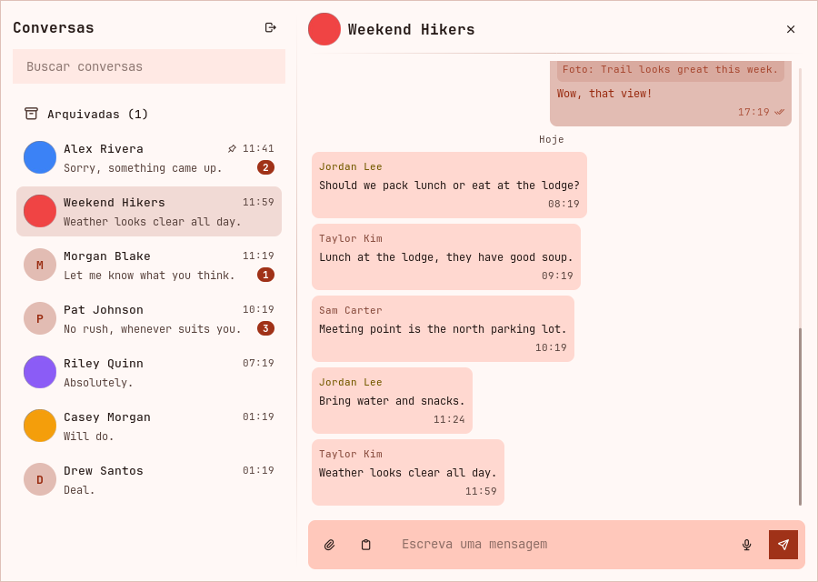
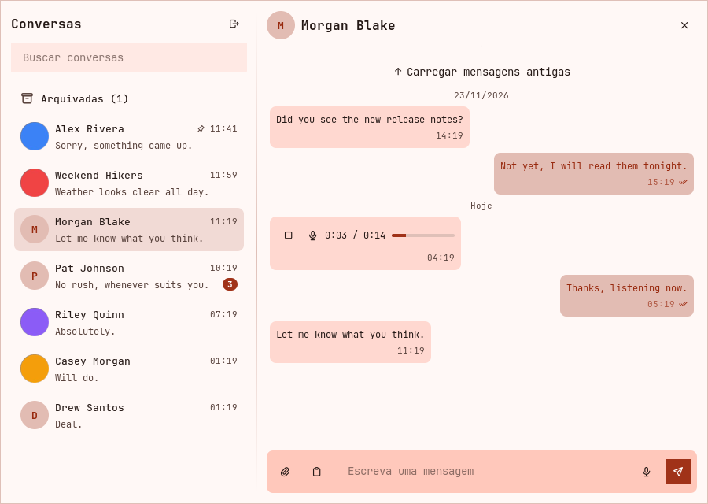
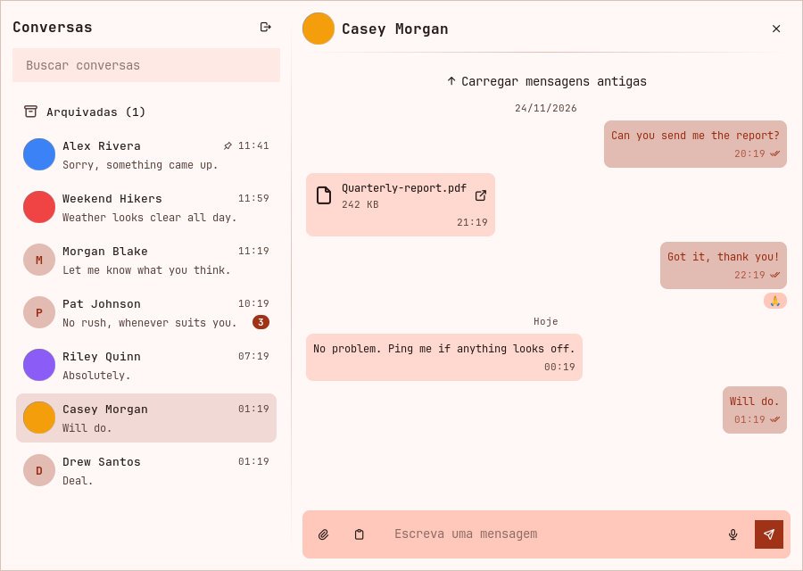

# Zap

A WhatsApp client for the Noctalia bar. It shows the unread count, lists your chats and opens a panel where you
read and send messages, voice notes, photos and documents. Login is by QR code, like WhatsApp Web.



| Group chat with a photo | Voice message playing | Document |
| --- | --- | --- |
|  |  |  |

Screenshots taken in demo mode with the Portuguese interface; all names and messages are made up.

## Plugin

| Field | Value |
| --- | --- |
| ID | `claudio-asj/zap` |
| Entries | Bar widget: `bar`; panel: `panel`, `panel_compact`, `panel_large`, `panel_full`; service: `service` |

## Requirements

- `noctalia-zapd`, the helper that talks to WhatsApp. Install it in one of two ways:
  - Download the binary from the releases of https://github.com/claudio-asj/noctalia-zap and put it in
    `~/.local/bin` or anywhere on `PATH`.
  - Build it from the `daemon/` directory of that repository. This needs Go and gcc.
- Optional, each one enables a feature:
  - `mpv` or `ffplay`: play voice notes and audio.
  - `ffmpeg` and `ffprobe`, plus `pw-record` (PipeWire): record and send voice notes.
  - `wl-clipboard`: paste images from the clipboard.
  - `xdg-desktop-portal` and a portal backend: the file picker for attachments.

## Usage

Add the `bar` widget in the bar settings. Clicking it opens the panel. The `service` entry starts with the plugin
and runs the helper.

To open the panel from a keybind or a terminal:

```sh
noctalia msg panel-toggle claudio-asj/zap:panel
```

The other sizes use the same command with a different id: `claudio-asj/zap:panel_compact`,
`claudio-asj/zap:panel_large` and `claudio-asj/zap:panel_full`. The `panel_size` setting picks the size the
widget opens.

First login: open the panel, then on the phone go to Settings, Linked devices, Link a device and scan the QR code
shown in the panel. The session is kept, so you only do this once.

Demo mode: turn on the advanced `demo` setting to browse made-up chats without an account. It uses its own data
folder and never connects to WhatsApp, so it is also the way to review the plugin or take screenshots.

## Settings

| Setting | Type | Default | Description |
| --- | --- | --- | --- |
| `panel_size` | `select` | `normal` | Size of the panel that opens from the bar: `compact`, `normal`, `large` or `full`. |
| `hide_when_empty` | `bool` | `false` | Hide the bar widget when there are no unread messages. |
| `notifications` | `bool` | `true` | Show a notification for new messages, with a reply button. Muted chats stay silent. |
| `notify_private` | `bool` | `false` | Show only "New message" in notifications instead of the text. |
| `history_limit` | `int` | `50` | How many recent messages to keep for each chat when syncing (10 to 500). Restarts the helper. |
| `download_dir` | `string` | empty | Where photos, videos and documents you open are saved. Empty means `Downloads/WhatsApp`. Audio stays in a private cache. Restarts the helper. |
| `media_cache_mb` | `int` | `500` | Size limit of the media cache in MB (50 to 10000). Restarts the helper. |
| `daemon_path` | `string` | empty | Full path to `noctalia-zapd`. Empty means search `PATH` and `~/.local/bin`. Advanced. |
| `demo` | `bool` | `false` | Run the helper in demo mode with fictional data. Restarts the helper. Advanced. |

## IPC

```sh
noctalia msg plugin claudio-asj/zap:service all toggle
noctalia msg plugin claudio-asj/zap:service all open <chat-jid>
```

`toggle` opens or closes the panel (at the size picked in settings). `open` opens the panel on a chat, the same
as clicking a notification.

## Notes

- This is an unofficial client. It is not made by or connected to WhatsApp or Meta, and WhatsApp can ban numbers
  that use unofficial clients. Use a secondary number, not the one you cannot lose.
- This is an early version (0.1.x). Expect rough edges.
- Data stays in the plugin data directory of Noctalia (`pluginDataDir`). It holds the WhatsApp session and the
  local message history. Neither leaves your machine, and the plugin never logs message contents. Demo data is
  kept in a `demo` subfolder there.
- Processes started: `noctalia-zapd` (always, by the service) and, when you use the matching feature, `mpv` or
  `ffplay` for audio and `pw-record` and `ffmpeg` for recording. Commands are run with argument lists, and
  message text is never put in a shell command.
- Network: only `noctalia-zapd` talks to the WhatsApp servers. Profile pictures are downloaded from the URLs
  WhatsApp provides. In demo mode there is no network use at all.
- Files you open from a chat are saved in the download folder (`Downloads/WhatsApp` by default).
