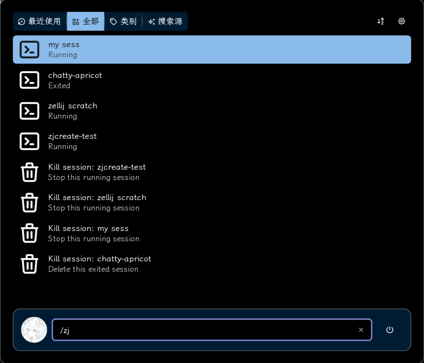
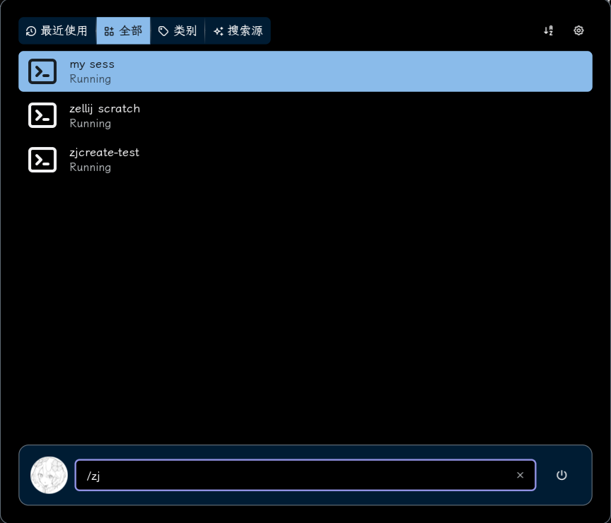
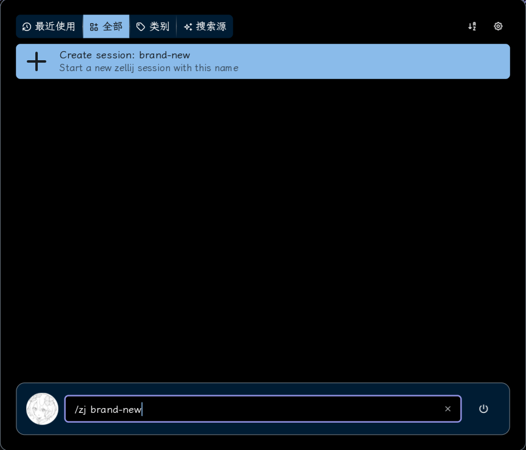

# zellij Provider

A launcher provider plugin for searching running [zellij](https://zellij.dev) sessions, or
zellij layout files, and attaching the sessions from the launcher.

This is a zellij fork of [`dunarand/tmux-provider`](https://github.com/noctalia-dev/community-plugins/tree/main/tmux-provider).
The UI, result ranking, and settings shape are kept as close to the original as possible so the two
plugins stay reviewable side by side; only the command layer and the optional second source differ.

## Plugin

| Field           | Value                         |
| --------------- | ----------------------------- |
| ID              | `tjswysqh-afk/zellij-provider` |
| Entry           | Launcher provider: `provider` |
| Launcher Prefix | `/zj`                         |

## Requirements

- Noctalia v5.0.0 or higher
- Requires `zellij`. Tested with zellij 0.45.1; session listing uses
  `zellij list-sessions --no-formatting`, which needs a recent zellij.

The optional layout source has no extra dependency: it asks zellij itself where its layout directory
is (`zellij setup --check`) instead of reimplementing zellij's path rules.



## Usage

Open the launcher and type what you are looking for after the `/zj` prefix, for example `/zj api`.
Running and exited sessions are listed; an exited session shows up as `Exited` and `zellij attach`
resurrects it.

Selecting a session and pressing Return / Enter launches the default terminal and attaches to it
with:

```sh
zellij attach <session>
```



When the query matches no session, the first row creates a session with that name instead:

```sh
zellij attach -c <query>
```



When the query matches no session, the first row creates a session with that name instead:

```sh
zellij attach -c <query>
```

With **Enable layouts** turned on, layout files from the zellij layout directory are listed after
the sessions. Selecting one starts a new session from it; zellij names that session itself.

With **Show kill actions** turned on, every session also gets a second row that stops a running
session (`zellij kill-session`) or deletes an exited one (`zellij delete-session`).

## Settings

| Setting             | Type   | Default | Description                                                                                                                              |
| ------------------- | ------ | ------- | ---------------------------------------------------------------------------------------------------------------------------------------- |
| `use_layouts`       | `bool` | `false` | Enables layout files to be included in the search. The layout directory is resolved through `zellij setup --check`.                      |
| `show_kill_actions` | `bool` | `false` | Adds a kill row per session. It acts immediately, so it is off by default.                                                               |

## Notes

Commands this plugin runs:

- Listing: `zellij list-sessions --no-formatting`, and `zellij setup --check` when layouts are
  enabled.
- Attaching: `zellij attach <session>`, `zellij attach -c <session>` to create, `zellij --layout
  <layout>` to start a session from a layout.
- Killing, only with `show_kill_actions`: `zellij kill-session <session>`, falling back to `zellij
  delete-session <session>` because `kill-session` refuses sessions that already exited.

Differences from `tmux-provider`:

- `tmux ls` / `tmux attach -t` / `tmuxp load` are replaced by the zellij commands above. zellij has
  no "attached" flag in its session list, so rows show `Running` or `Exited` instead of
  `Attached` / `Detached`.
- The optional `tmuxp` source becomes `use_layouts`: zellij layouts are the native equivalent of
  tmuxp session files, and they are started by name instead of loaded through a separate tool.
- `show_kill_actions` is new, because zellij is commonly used with detached sessions that outlive
  their terminal.
- zellij reports "no sessions" with exit code `1` and a message on stderr rather than on stdout, so
  a non-zero exit is treated as the empty state and only unexpected stderr is logged.

`zellij list-sessions` also exits non-zero when the zellij binary is present but no session server
is running; that is a normal empty state, not an error.

The original plugin was written by [dunarand](https://github.com/dunarand) and is MIT licensed; this
fork keeps the same license. All credit for the design, structure, and original tmux implementation
goes to the upstream author.
